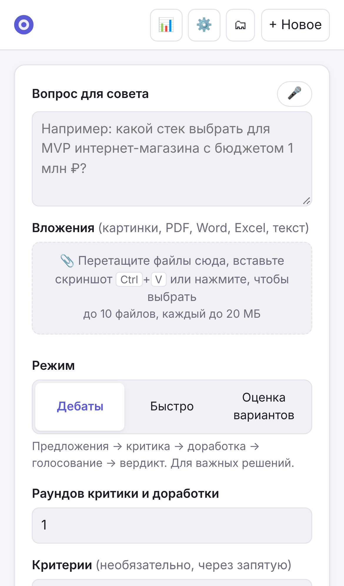
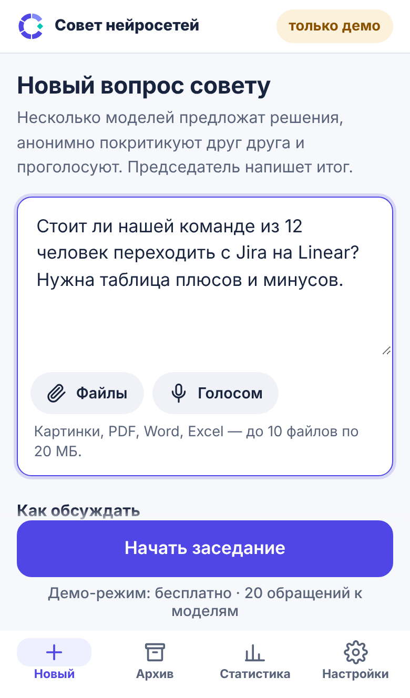
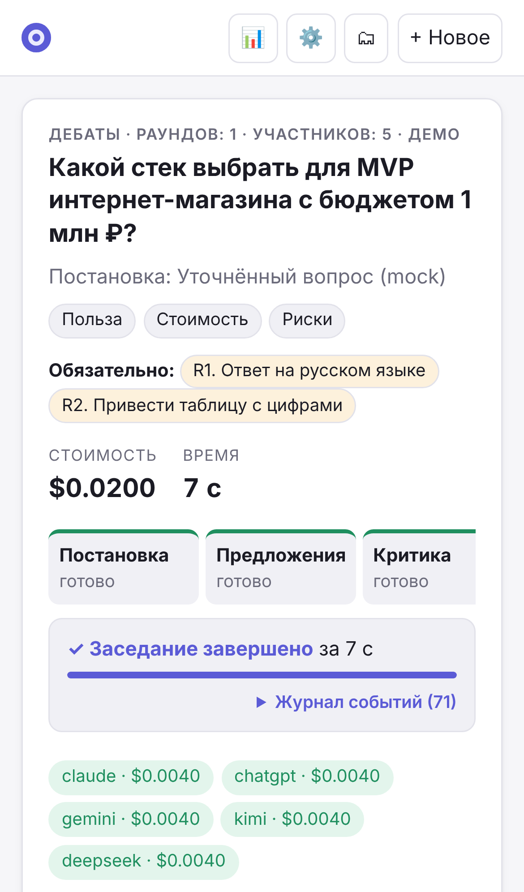
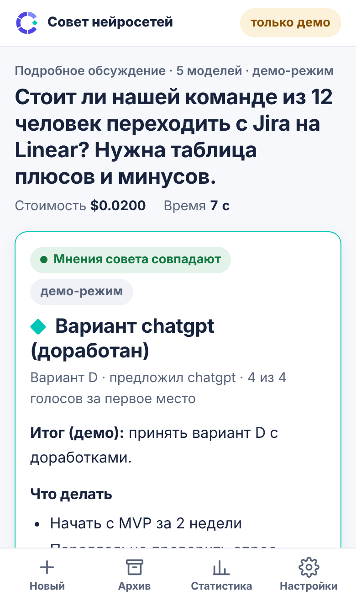

# Переработка интерфейсов: веб и Telegram

Ветка: `claude/ui-redesign`. Логика совета, промпты и подсчёт голосов не менялись. Установка, `docker compose` и команда
`ai-council` работают как раньше. Всё разрабатывалось и проверялось только в демо-режиме, без трат на модели.

Скриншоты «было / стало» — в папке [`docs/redesign/`](redesign/).

| Было | Стало |
|---|---|
|  |  |
|  |  |

---

## 1. Что было не так

Аудит проводился по скриншотам на телефоне (iPhone 13, 390 px) и компьютере (1440 px) в светлой и тёмной теме и по
прохождению сценариев «задать вопрос → дождаться → прочитать решение → скачать / уточнить».

### Веб на телефоне — главное

1. **До кнопки «Начать» нужно прокрутить около трёх экранов.** На первом экране сразу около 15 полей: критерии,
   участники, председатель, адвокат дьявола, лимит, три галочки. Большинству людей они не нужны.
2. **Ответ совета не первым.** После заседания сверху шли этапы, журнал и расходы по моделям, а решение — только на втором экране.
3. **Страница длиной около 21 000 пикселей.** Под результатом на телефоне повторялись форма и список заседаний.
4. **Значки без подписей в шапке** (📊 ⚙️ 🗂). Эмодзи выглядят по-разному на разных телефонах. Баланс теснился с кнопками.
5. **Лента этапов не помещалась** — было видно 3 из 6, остальное обрезано.
6. **iPhone увеличивал страницу при вводе.** Текст в полях был 15 px, а Safari приближает страницу при касании поля мельче 16 px.
7. **Список участников с отдельной прокруткой** внутри прокручиваемой страницы — неудобно пальцем.

### Веб — везде

- 12 кнопок скачивания над ответом: 3 вида отчёта × PDF / Word / Markdown / «Открыть».
- Язык специалиста в результате: «Шульце», «Борда», «τ = 0.62», «Постановка: …», без простой фразы о том, кто победил и насколько уверенно.
- Подробности в таблице критики — только при наведении мыши, на телефоне недоступны.
- Системные окна `confirm()` и `alert()` для подтверждения стоимости и удаления: мелкие, без пояснений.
- Устаревший текст на стартовом экране («Заполните форму слева», «подсчёт по Борда»).
- Мелкие цели для нажатия: крестики удаления, галочки 13 px. В окне варианта фокус клавиатуры уходил за его пределы.
- Настройки на телефоне: вкладки переносились в 3 строки, таблица моделей уезжала вбок, «Сохранить» — только вверху.

### Telegram

- В карточке вопроса 5 рядов кнопок: настройки перемешаны с «Начать».
- Сообщение о ходе заседания — плотная стена текста, строка этапов переносится.
- Под результатом 7 кнопок, три почти одинаковые («Отчёт PDF», «Итог PDF», «Только решение PDF»).
- `/settings` только описывал настройки, поменять ничего было нельзя.
- В архиве кнопки «1»…«8», по которым не понять, какое заседание.
- Markdown-таблицы из ответов приходили «сырыми» строками `| a | b |` — в Telegram нет таблиц.
- Внутренняя ошибка показывалась как `repr(e)`.

---

## 2. Что и почему изменено

### Основа оформления

- **Цвета в переменных** и тёмная тема. Спокойный тёплый фон, один акцентный цвет, золотая рамка у решения.
  Подписи контрастом не ниже 4,5:1, проверено axe-core.
- **Набор SVG-значков** в самой странице вместо эмодзи: одинаково выглядят везде, не нужны внешние файлы и сборка.
- **Системный шрифт, базовый размер 16 px**, поля ввода не мельче 16 px (iPhone больше не увеличивает страницу).
- **Цели для пальца не меньше 44 px.** Переключатели-тумблеры вместо мелких галочек, но внутри это обычные
  `<input type="checkbox">`, поэтому экранные дикторы и клавиатура работают как раньше.
- **Без фреймворков и сборки**, как и было: тот же `index.html` + `app.js` + `settings.js` + `style.css`.
  Развёртывание не меняется.

### Логотип и цвета

- Логотип — пакет «Совет нейросетей» (пять сегментов «совета» и бирюзовый ромб «решения»). Исходники лежат в
  [`docs/brand/`](brand/): SVG в кривых, PNG, иконки для приложений, палитра, `README_RU.txt` пакета.
- **Знак в меню** встроен в страницу и сам меняет цвета по теме: на светлой — индиго и светлый индиго,
  на тёмной — белые сегменты (вариант `reversed`). Бирюзовый ромб одинаков в обеих темах.
- **Иконки:** `favicon.ico` и векторная иконка для вкладки, `apple-touch-icon` для экрана «Домой» на iPhone.
- **Палитра интерфейса взята из логотипа:**
  - светлая тема — фон `paper` #F7F8FB, текст `navy` #18233D, акцент `indigo` #4F46E5;
  - тёмная тема построена на `navy`;
  - **бирюзовый `turquoise` #00C7B5 — цвет решения**: рамка карточки решения, ромб перед его названием,
    отметка «решение» у варианта и победителя в голосовании. В логотипе ромб так и называется — `mark-decision`.
- Цвет отчётов по умолчанию — индиго логотипа (#4F46E5).

### Навигация

- **На компьютере** — меню слева: «Новый вопрос · Архив · Статистика · Настройки» и под ним «Недавние» заседания.
  Баланс OpenRouter внизу меню.
- **На телефоне** — нижняя панель с подписями (зона большого пальца), сверху только название и баланс.
- Текущий раздел подсвечен (`aria-current`). Есть ссылка «Перейти к содержимому» для клавиатуры.

### Новый вопрос

- **На экране самое нужное:** поле вопроса с кнопками «Файлы» и «Голосом» (файлы можно и перетащить на поле, и вставить
  скриншот), выбор режима карточками с понятными названиями: «Подробное обсуждение», «Быстрый ответ»,
  «Выбрать из моих вариантов».
- **Остальное — в свёрнутых «Параметрах»** с итоговой строкой «5 моделей · председатель claude · 1 раунд · лимит $2».
  Участники — сеткой кнопок, без вложенной прокрутки.
- **Кнопка «Начать» всегда видна**: на телефоне прилипает к низу над панелью, на компьютере — в правой колонке.
- **Стоимость считается сама** через 0,7 с после ввода, без кнопки «Оценить»: «Оценка: $0.31 – $0.78 · баланса хватит».
  Нажатие раскрывает подробности. Красным — если не хватает баланса или есть неизвестные модели.
- **Своё окно подтверждения** со стоимостью, режимом и предупреждениями вместо `confirm()`. На телефоне оно выезжает снизу.

### Заседание

- **Пока идёт** — «Этап 3 из 6: Критика · готово 2 из 5 · 0:42», общая полоса прогресса и вертикальный список этапов.
  У пройденных этапов — итог («4 варианта: A, B, C, D»), у текущего — что происходит простыми словами и строки моделей
  («думает · 1:20», «пишет ответ · ≈800 ток.»). Если заседание прервано, видно, на каком этапе.
- **После — сначала решение:**
  - метки «Мнения совета совпадают / частично расходятся / разошлись», «Ничья за первое место»,
    «Председатель выбрал не лидера», «Есть опровергнутые факты»;
  - заголовок — название решения, под ним «Вариант D · предложил kimi · 4 из 5 голосов за первое место»;
  - ответ целиком;
  - кнопки «Уточнить», «Повторить», «Скачать» (одно меню: три вида отчёта с пояснениями и форматы).
- **Ниже — свёрнутые и короткие разделы:**
  - «Почему так, риски и особые мнения»;
  - «Голосование» — одна фраза и полосы по местам, а таблица Шульце/Борда, бюллетени и методика — в «Как считали»;
  - «Все варианты»;
  - «Критика» — оценка открывается касанием;
  - «Журнал событий».

### Архив, статистика, настройки

- **Архив** — карточки с решением, датой («сегодня, 19:50»), меню «Скачать» и кнопкой удаления, удаление через своё окно.
- **Настройки** — вкладки в одну прокручиваемую строку. На телефоне таблица моделей превращается в карточки.
  Кнопка «Сохранить» появляется внизу, только когда есть изменения.
- **Статистика** — карточки показателей, таблицы прокручиваются вбок и доступны с клавиатуры.

### Telegram

- **Карточка вопроса:**
  - сначала коротко: режим, «5 моделей · председатель claude», «≈ $0.31 – $0.78 · баланс $12.40»;
  - кнопки «▶️ Начать / ⚙️ Настроить / ✖️ Отмена»;
  - режим, раунды, участники и переключатели (✅/▫️) открываются экраном «Настроить» в той же карточке.
- **`/settings` с кнопками** — те же настройки, меняются прямо в сообщении.
- **Ход заседания** — полоса «▰▰▱▱▱▱ Этап 3 из 6: Критика», пояснение этапа, строка на модель, стоимость и время.
- **Решение:**
  - «🏆 Решение: …», «вариант D · предложил kimi · 4 из 5 за первое место», 3–5 строк сути, «🟢 Мнения совета совпадают»;
  - кнопки «📖 Полный ответ · 📊 Голоса · 📄 Отчёт PDF · 📎 Другие форматы · 💬 Уточнить · 🔁 Повторить».
- **Архив** — кнопки с названиями заседаний.
- **Таблицы из ответа** превращаются в пункты «• Конверсия — Цель: ≥ 3%».
- **Понятные сообщения об ошибках**, короткая справка, команды по частоте использования.

### Изменения в API и поведении — все с обратной совместимостью

- В событие `start` заседания добавлено поле `fact_check` — чтобы список этапов заранее показывал проверку фактов.
  Старые клиенты его просто игнорируют.
- `/` отдаёт `index.html` с `Cache-Control: no-cache` и метками версии у `app.js`, `settings.js` и `style.css`
  (`?v=<хеш>`). Без этого после обновления браузер мог взять старый скрипт к новой разметке.
- **Telegram:**
  - новые кнопки `view:opts`, `set:*` (для `/settings`) и `res:fmt:*` («Другие форматы»);
  - все прежние кнопки (`mode:*`, `rounds:*`, `demo`, `facts`, `compact`, `mem:*`, `rep:*`, `res:more|tally`) по-прежнему
    работают — в том числе в сообщениях, отправленных до обновления;
  - формат настроек чата (`telegram_settings.json`) не изменился.

---

## 3. На что опирался

- **WCAG 2.2 (W3C)**: 2.5.8 «Размер цели — минимум» (24×24 px, мы держим 44 px как в HIG),
  2.4.11 «Фокус не перекрыт», контраст 1.4.3 (4,5:1), 1.3.1 — заголовки по порядку.
  [What's New in WCAG 2.2](https://www.w3.org/WAI/standards-guidelines/wcag/new-in-22/), [WebAIM: WCAG 2.2](https://webaim.org/standards/wcag/wcag22).
- **Apple Human Interface Guidelines / Material Design**: цели для пальца 44 pt / 48 dp,
  нижняя панель для 3–5 основных разделов.
- **NN/g, «4 principles to reduce cognitive load in forms»**: одна колонка, предсказуемый порядок, постепенное раскрытие
  (progressive disclosure) редких полей. [nngroup.com](https://www.nngroup.com/articles/4-principles-reduce-cognitive-load/)
- **Baymard Institute, исследования мобильных форм**: подписи над полями, никаких подсказок только в placeholder,
  крупная основная кнопка. [baymard.com](https://baymard.com/blog/mobile-checkout)
- **Telegram Bot Features и практики inline-клавиатур**: править сообщение на месте вместо новых,
  отвечать на каждое нажатие, 2–3 кнопки в ряду на телефоне, длинные меню — отдельным экраном.
  [core.telegram.org/bots/features](https://core.telegram.org/bots/features)
- **iOS Safari**: поля мельче 16 px вызывают увеличение страницы при касании. Известное поведение, поэтому 16 px.

---

## 4. Что проверено

- **Автотесты: 159 прошли.** Из них 5 новых: интерактивный `/settings`, «Другие форматы», старые кнопки карточки,
  таблицы → списки, метка версии статики. Тесты карточки бота обновлены под новую раскладку.
- **Доступность — axe-core 4.10** (WCAG 2.0/2.1/2.2 A и AA + рекомендации):
  - пять экранов (новый вопрос, заседание с раскрытыми разделами, архив, настройки, статистика);
  - телефон и компьютер, светлая и тёмная тема;
  - **0 нарушений**. Найденные по ходу проблемы исправлены: контраст золотой метки, порядок заголовков,
    прокручиваемые таблицы без фокуса, пустой заголовок столбца.
- **Скриншоты:** 360 / 390 (iPhone 13) / 768 / 1024 / 1280 / 1440 px, обе темы. Горизонтальной прокрутки страницы нет
  ни на одной ширине. Ошибок JavaScript в консоли нет.
- **Сценарии в демо-режиме, от начала до конца:**
  - вопрос → автооценка → параметры → запуск → ход → решение → меню «Скачать» → «Как считали» → отзыв из таблицы критики;
  - остановка заседания через своё окно;
  - прерывание по лимиту бюджета;
  - «Уточнить» (форма с пометкой «Уточнение к …»);
  - «Повторить» (форма заполнена, «Параметры» раскрыты);
  - загрузка файла;
  - режим «Выбрать из моих вариантов» с проверкой «нужно минимум 2 варианта»;
  - удаление из архива;
  - окно варианта на телефоне.
- **Клавиатура:**
  - первый Tab — «Перейти к содержимому», порядок Tab логичный;
  - стрелки переключают режим;
  - Tab не выходит из открытого окна, Esc закрывает окна и меню и возвращает фокус на кнопку.
- **Telegram:** прогон бота с поддельным Telegram в демо-режиме и отрисовка переписки (`docs/redesign/after-telegram.png`):
  карточка, «Настроить», ход заседания, решение, «Другие форматы», `/settings`, `/archive`, `/help`.

## 5. Что проверить не удалось

- **Настоящий Telegram.** В песочнице нет доступа к Telegram API: кнопки и тексты проверены через поддельный API.
  Ограничения длины (4096) и `callback_data` (64 байта) соблюдаются, но вид в разных клиентах (iOS / Android / Desktop)
  нужно посмотреть глазами.
- **Настоящие модели.** Только демо-режим (так и требовалось). Реальные ответы длиннее: стоит посмотреть, как выглядят
  длинные решения и широкие таблицы.
- **Реальные телефоны и Safari.** Проверено в Chromium с эмуляцией iPhone. Safari на iOS, нижний вырез экрана
  (`safe-area`) и голосовой ввод (микрофон работает только по HTTPS) нужно проверить на устройстве.
- **Экранные дикторы** (VoiceOver, TalkBack) не запускались — только автоматическая проверка axe-core и клавиатура.
- **Сборка Docker и обновление на сервере** из песочницы недоступны. Изменены только файлы программы, Dockerfile и
  compose не трогались.

## 6. Что предлагаю дальше

1. **Короткая «живая» строка на экране нового вопроса:** «Ваше последнее заседание: …» с кнопкой «Уточнить» — чаще всего
   люди продолжают начатое.
2. **Push-уведомления в браузере на телефоне** (PWA с manifest и service worker) — сейчас уведомление приходит, только если
   вкладка открыта.
3. **Выбор темы вручную** (светлая / тёмная / как в системе) — переменные для этого уже есть (`data-theme`).
4. **Telegram Mini App** для настроек моделей (меню из 10 моделей удобнее в мини-приложении, чем кнопками),
   если пользователей станет больше.
5. **Примеры вопросов** на пустом экране нового вопроса для новичков (2–3 кнопки-подсказки).
6. **Проверка на реальных устройствах** с 2–3 пользователями: 5 минут на сценарий «задать вопрос и найти итог».

## Правки по экспертному разбору интерфейса (ноябрь 2026)

| Что | Было | Стало |
|---|---|---|
| Подсказка цены | «Напишите вопрос — покажу стоимость» висела при заполненном поле | «Оцениваем стоимость…», затем оценка и бюджет в одной строке |
| Новый вопрос | «Новый вопрос совету», длинное вступление, «Как обсуждать» | «Задайте вопрос», одна фраза + «Как работает совет» по запросу, видимая подпись «Ваш вопрос», «Какой ответ нужен?» |
| Состав | «Параметры», подсказка «смотрите Настройки» | «Состав и параметры · Готовый/Ваш состав · N моделей · бюджет · Изменить»; подсказки о ролях рядом с полями |
| Подбор состава | «✨ Подобрать состав», «подбор по правилам», «ваша история» | «Предложить состав для этой задачи» (необязательно, цена отдельно), понятные метки источника; после применения — «Отменить» |
| Бюджет | «Заседание остановится…» | честное описание резерва: пауза до превышения, полученное сохраняется |
| Ход заседания | «Остановить» (на деле — пауза), «Постановка», «Арбитраж доказательств», «Синтез» | «Пауза» с понятным диалогом; «Уточняем задачу», «Ищем слабые места», «Проверяем утверждения по источникам», «Готовим вывод» (и в боте) |
| Результат | заголовок-запрос + цитата запроса, техническое «общий каркас — вариант D», зелёная метка согласия | короткий заголовок, «Исходный вопрос ▾» свёрнут, карточка решения — первой; «Основания: подтверждено N из M» / «Факты не проверялись» отдельно от нейтральной «Модели согласны с выбором»; стоимость округлена |
| Карточки вариантов | затухание текста, «(доработано)» дважды, «Читать полностью» | фрагмент без затухания, одна метка, «Открыть полный ответ»; «Как получен результат голосования» |
| Статистика | «0 / 0», «0 из 0 побед» у председателя | «С файлами» и «Уточнений» отдельно; «Выбрано лучшим», «не предлагала» с объяснением; этапы расходов — понятными словами |
| «Недавние» | «решение D» | режим заседания |
| Навигация | у открытого заседания не подсвечен раздел | подсвечен «Архив» |
| Телефон | на низком экране кнопка запуска поверх полей | при высоте до 560 px — в общем потоке; касаемые элементы ≥ 44 px; видимый фокус; `prefers-reduced-motion` |
| Отчёт «Только решение» | без карточки | карточка решения первой |
| Настройки | «Факты и голос», «Выбрать другую модель этого разработчика…» | «Проверка и голосование», «Заменить модель» |

Не сделано и почему: названия режимов не менялись (они одинаковы в отчётах, боте и архиве); палитра не менялась
(цвета уже заданы токенами — менять без замера контраста текущих пар не стоит); «Завершить сейчас» с итогом из
неполных данных не сделано — вместо него пауза и «Удалить»; «председатель» оставлен (с пояснением «пишет итог»).
